# UNIVERSIDAD TECNOLÓGICA DEL PERÚ (UTP)

**FACULTAD DE INGENIERÍA**  
**CARRERA PROFESIONAL DE INGENIERÍA DE SISTEMAS E INFORMÁTICA**  
**SERVICIOS CLOUD - 50883**  
**PROYECTO FINAL — CLOUD COMPUTING**

**TEMA:**  
PLATAFORMA WEB DE VENTA DE LIBROS SOBRE UNA ARQUITECTURA CLOUD HÍBRIDA: AWS Y SUPABASE (**BOOKLY**)

**DOCENTE:**  
LIDIA MARLENY QUINDE NUÑEZ

**ESTUDIANTE:**  
ANGELES KRYSTHEL ESPINOZA CASTILLO

**FECHA:** 26 de noviembre de 2026

---

## 1. Planteamiento del Problema

### 1.1 Descripción del problema
Las librerías independientes y cadenas medianas de venta de libros en el Perú dependen frecuentemente de atención presencial o coordinación manual por redes sociales, lo que genera catálogos desactualizados, riesgo de sobreventa por falta de control transaccional de stock, ausencia de trazabilidad de pedidos, falta de indicadores de gestión y vulnerabilidad ante picos estacionales de demanda.

**Solución implementada (BOOKLY):** Sistema web Full Stack de tres capas compuesto por Frontend SPA en React + TypeScript, Backend API REST modular en FastAPI + SQLAlchemy 2.0 + Alembic y capa gestionada en Supabase (PostgreSQL, Auth, Storage y RLS), acompañado de definición Infraestructura como Código (Terraform) para AWS Multi-AZ (S3 + CloudFront OAC, ALB, EC2 Auto Scaling, ECR, Secrets Manager y CloudWatch), Docker y CI/CD en GitHub Actions. Precios expresados en soles peruanos (`S/`) y pagos simulados con fines académicos.

> **Estado verificado al 26/11/2026:**
> - Repositorio GitHub: `https://github.com/Krysthel1/bookly-cloud` (rama `main`).
> - Supabase (`fbnlsxgzriipvybfznbu`, región `aws-1-us-west-2`): **23 tablas**, **42 libros**, **18 autores**, **8 categorías**, **8 editoriales**, **3 cupones**, **3 buckets de Storage** (`book-covers`, `book-images`, `avatars`), RLS activo y usuario administrador asignado (`krysthelespinoza.10@gmail.com`).
> - AWS y k6: definidos en código (`infrastructure/terraform/` y `tests/load/`), pendientes de despliegue autorizado (`terraform apply`) y medición en entorno AWS.

### 1.2 Objetivos del proyecto
- **Objetivo general:** Diseñar, implementar y documentar una arquitectura Cloud híbrida (AWS + Supabase) para BOOKLY que sea disponible, escalable, segura y costo-eficiente.
- **Objetivos específicos medibles:**
  - **OE1 (Disponibilidad):** Arquitectura Multi-AZ con `min_size = 2` instancias detrás de ALB con `/health` y `/ready`, objetivo de diseño 99,9 % y recuperación automática < 5 min.
  - **OE2 (Latencia y errores):** Latencia `p95 < 500 ms` y tasa de errores `< 1 %` hasta 100 usuarios concurrentes en k6.
  - **OE3 (Escalabilidad):** Auto Scaling Group de 2 a 4 instancias con política Target Tracking `CPUUtilization > 60 %`.
  - **OE4 (Costo):** Presupuesto mensual proyectado para Entorno A (económico) y Entorno B (alta disponibilidad), con alertas AWS Budgets al 80 %.

### 1.3 Alcance y restricciones
Incluye tienda pública, autenticación Supabase Auth, portal *Mi Cuenta*, checkout transaccional en 5 etapas con `Idempotency-Key`, panel administrativo completo (Dashboard Recharts, CRUD libros/categorías/autores/cupones, inventario kardex, pedidos, clientes con historial, reportes CSV con filtro de fechas y auditoría), Docker, GitHub Actions, Terraform y scripts k6. No procesa cobros reales ni despliega recursos de pago en AWS sin autorización.

---

## 2. Análisis de Requisitos y Atributos de Calidad

### 2.1 Requisitos funcionales (RF-01 a RF-23)
Todos los requisitos RF-01 a RF-23 están implementados en frontend y backend con persistencia real en Supabase PostgreSQL:
- **Visitante:** Catálogo paginado, búsqueda por título/autor/ISBN, filtros, detalle del libro, reseñas, registro/login/recuperación (`RF-01`, `RF-02`, `RF-04`, `RF-05`).
- **Cliente:** Perfil, direcciones, carrito persistente en PostgreSQL, favoritos, cupones, checkout en 5 etapas con pagos simulados (`tarjeta`, `yape`, `plin`, `contra_entrega`), historial, seguimiento, cancelación con devolución única de stock, reseñas y notificaciones (`RF-03`, `RF-06`–`RF-13`).
- **Administrador:** Dashboard KPIs + 6 gráficos Recharts con filtro de fechas, CRUD de libros con subida a Supabase Storage, CRUD de categorías y autores con búsqueda y paginación, inventario kardex, pedidos con detalle y transiciones autorizadas, clientes con filtro e historial de compras, cupones, reportes CSV con filtro de fechas y auditoría (`RF-14`–`RF-22`).
- **Infraestructura:** `GET /health` y `GET /ready` (`RF-23`).

#### Figura 2. Diagrama de casos de uso de BOOKLY
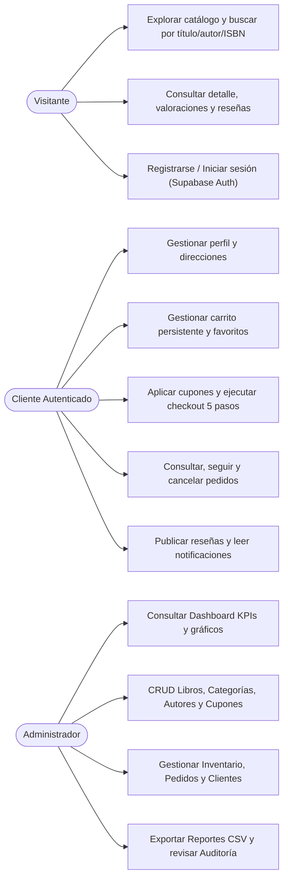

*(Figura 3 — Captura de Swagger UI: abrir `http://127.0.0.1:8000/docs` en idioma original sin traducción automática del navegador).*

### 2.2 Requisitos no funcionales y viabilidad
- Disponibilidad objetivo: **99,9 %** (análisis compuesto: ALB 99,99 % × EC2 Multi-AZ 99,99 % × Supabase 99,9 % ≈ **99,88 %**). **Diferencia clave:** Supabase Free no incluye SLA ni backups garantizados; para cumplir RPO de 24 h y SLA real se requiere Supabase Pro.
- Latencia objetivo: **p95 < 500 ms**, tasa de errores **< 1 %**, **RTO = 60 min** (Terraform + ECR), **RPO = 24 h** (backups diarios Supabase Pro).

### 2.3 Justificación de modelos de servicio
- **IaaS (EC2, VPC, Subredes, NAT, SG):** control total de red, aislamiento privado y demostración de balanceo y autoescalamiento.
- **Servicios Gestionados / PaaS (S3, CloudFront, ALB, ECR, CloudWatch, Secrets Manager):** elimina operación manual de balanceadores, CDN y logs.
- **BaaS / DBaaS (Supabase PostgreSQL, Auth, Storage):** evita administrar motor de BD y servidor de identidad propios, manteniendo la lógica de negocio en FastAPI.

---

## 3. Diseño de Arquitectura Cloud

### 3.1 Buenas prácticas (AWS Well-Architected Framework)
Aplicado en los 6 pilares: IaC con Terraform y CI/CD con OIDC (Excelencia operativa), subredes privadas + IMDSv2 + JWKS + RLS + Secrets Manager (Seguridad), Multi-AZ + transacciones ACID + `Idempotency-Key` (Fiabilidad), CloudFront + Supavisor `NullPool` + WebP (Desempeño), `env-a.tfvars` vs `env-b.tfvars` + AWS Budgets (Costos) y escalado al mínimo (Sostenibilidad).

### 3.2 Diagramas de Arquitectura y Secuencia

#### Figura 4. Arquitectura lógica de tres capas de BOOKLY
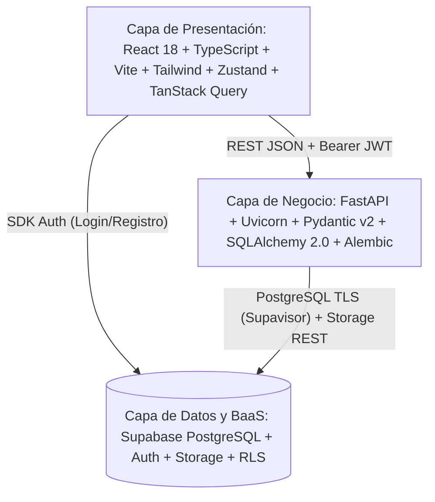

#### Figura 5. Diagrama de componentes del backend FastAPI
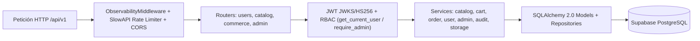

#### Figura 6. Arquitectura Cloud de BOOKLY (AWS + Supabase externo)
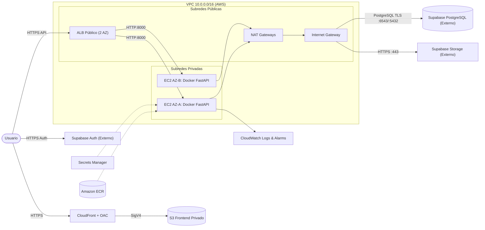

#### Figura 8. Secuencia de autenticación y autorización
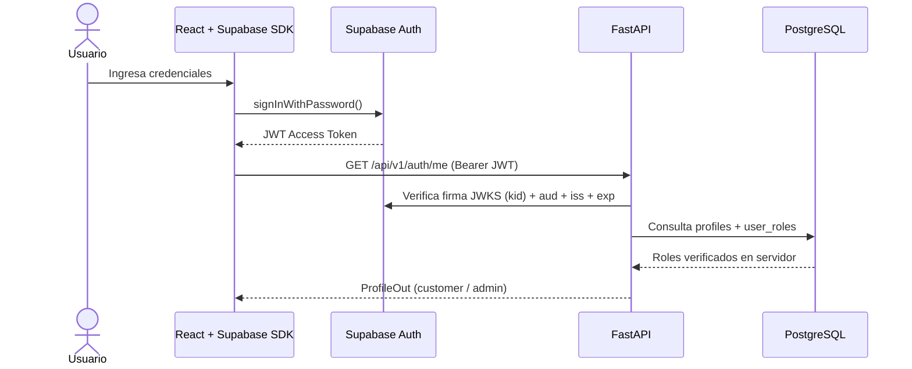

#### Figura 9. Secuencia de compra (checkout transaccional)
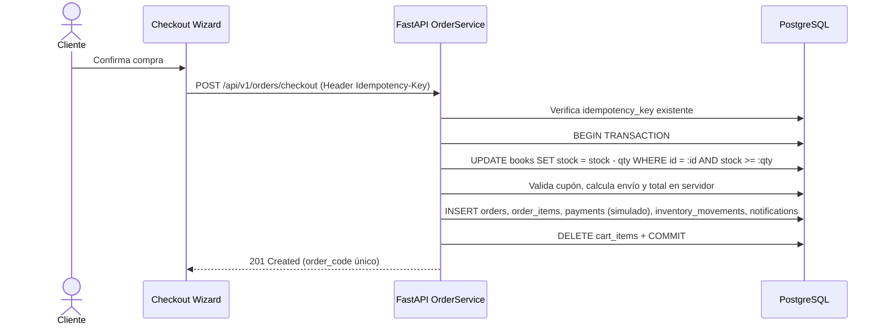

#### Figura 10. Flujo CI/CD en GitHub Actions
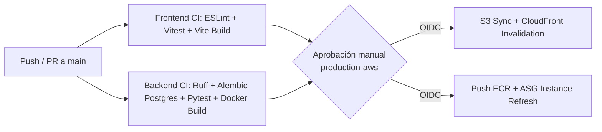

### 3.3 Diseño de red y conectividad

#### Figura 11. Topología de red VPC `10.0.0.0/16`
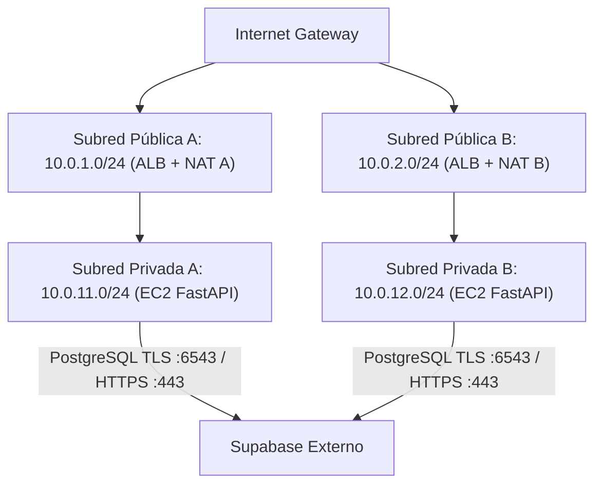

### 3.4 Capa de cómputo y almacenamiento (23 Tablas)

#### Figura 13. Modelo ER (Parte 1: Identidad y Catálogo)
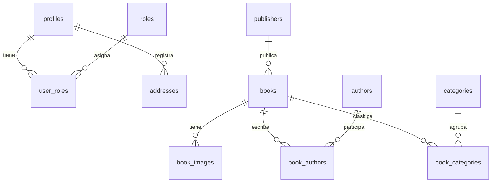

#### Figura 14. Modelo ER (Parte 2: Carrito, Favoritos, Reseñas, Inventario y Auditoría)
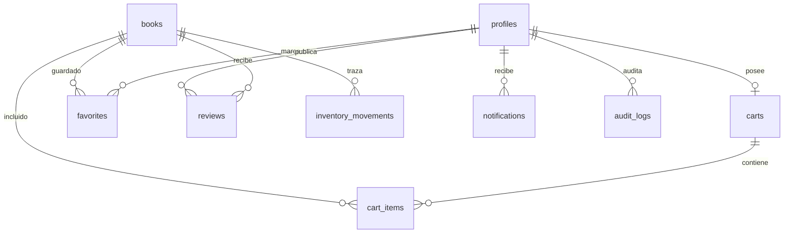

#### Figura 15. Modelo ER (Parte 3: Pedidos, Pagos y Cupones)
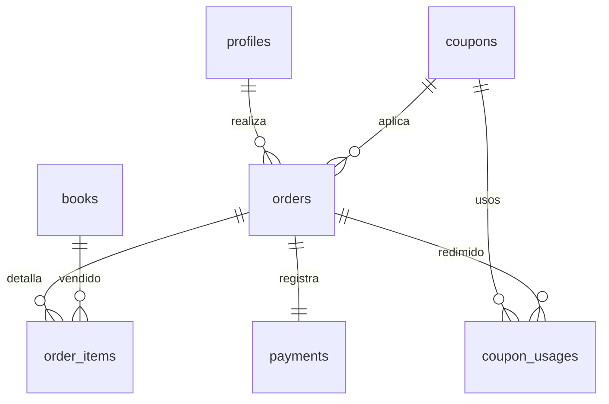

### 3.5 Decisiones Arquitectónicas (ADR)
Documentadas en [`docs/adr/README.md`](adr/README.md) (ADR-01 a ADR-08).

---

## 4. Observabilidad, Pruebas y Optimización de Costos

### 4.1 Monitoreo y registros
Configurado en [`infrastructure/terraform/monitoring.tf`](../infrastructure/terraform/monitoring.tf) y `ObservabilityMiddleware` (`request_id`, `method`, `path`, `status_code`, `latency_ms`), con alarmas SNS para CPU > 85 %, memoria CWAgent > 80 %, `TargetResponseTime p95 > 0.5 s`, errores 5xx, `UnHealthyHostCount >= 1` y `aws_budgets_budget` al 80 %.

### 4.2 Pruebas automatizadas, carga y resiliencia
- **Pruebas automatizadas verificadas:**
  - Backend: `ruff check` (`All checks passed!`) y `pytest -v` (`4 passed`: `/health`, `/ready`, verificación JWT, RBAC 401/403, catálogo/CRUD, checkout idempotente, concurrencia/stock, aislamiento entre clientes y devolución única de stock).
  - Frontend: `npm run lint` (`0` errores), `npm test` (`5 passed`: `BookCard` S/, `CartPage`, validación Zod en `LoginPage`, `ProtectedRoute`, `EmptyState`) y `npm run build` (`vite build` exitoso).
- **Pruebas k6 y resiliencia:** Definidas en [`tests/load/catalog.js`](../tests/load/catalog.js), [`tests/load/checkout.js`](../tests/load/checkout.js) y [`tests/load/stress.js`](../tests/load/stress.js) para escenarios `10`, `25`, `50`, `100` y `200` VUs. Pendientes de ejecución sobre entorno AWS desplegado.

### 4.3 Estimación y optimización de costos (FinOps)

#### Figura 28. Comparación de costos mensuales referenciales por entorno (USD)
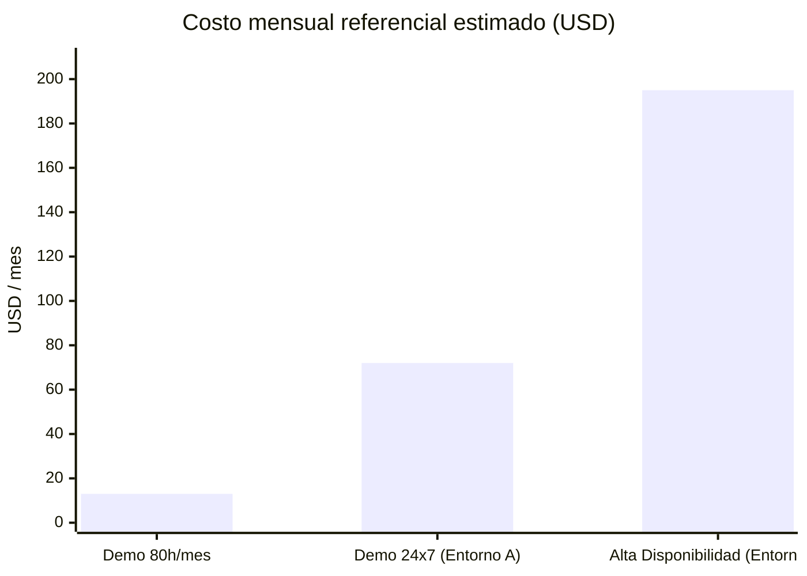

Perfiles listos en Terraform: [`env-a.tfvars`](../infrastructure/terraform/env-a.tfvars) (económico: `t3.small`, `min=1`, `nat_gateway_count=1`, logs 14d, budget \$75) y [`env-b.tfvars`](../infrastructure/terraform/env-b.tfvars) (HA: `t3.medium`, `min=2/max=4`, `nat_gateway_count=2`, logs 30d, budget \$200).

---

## 5. Conclusiones, Lecciones Aprendidas y Referencias

### 5.1 Conclusiones
1. El sistema **BOOKLY** implementa de extremo a extremo la arquitectura de tres capas con persistencia real en Supabase PostgreSQL (23 tablas), Supabase Auth y Supabase Storage (`book-covers`, `book-images`, `avatars`), garantizando integridad transaccional y seguridad RBAC en el servidor FastAPI.
2. Las pruebas unitarias e integración (`Pytest 4/4` y `Vitest 5/5`) confirman el funcionamiento del catálogo, carrito, checkout idempotente, control de stock y aislamiento entre clientes.
3. La infraestructura Terraform en [`infrastructure/terraform/`](../infrastructure/terraform/main.tf) modela los dos entornos de red, cómputo y observabilidad en AWS; su despliegue real (`terraform apply`) y pruebas de carga k6 quedan pendientes de autorización de recursos AWS.

### 5.2 Lecciones aprendidas y trabajo futuro
- Compatibilidad de `sb_publishable_` / `sb_secret_` modernos con Supabase REST API y JWKS (`RS256`/`ES256` + `HS256`).
- Uso de Supavisor Transaction Pooler (`6543`, IPv4, `NullPool`) en runtime frente a Session Pooler (`5432`) para migraciones DDL de Alembic en entornos IPv4.

### 5.3 Referencias
Ver sección completa de referencias oficiales AWS, Supabase, FastAPI, SQLAlchemy, Alembic, Terraform, k6, Docker y React en [`README.md`](../README.md).

---

## Anexo A — Guía rápida para completar tus capturas reales en Word
Las únicas capturas que faltan pegar en tu `.docx` son las tomadas directamente en tu navegador o consola (no se generan capturas simuladas):
1. **Aplicativo vivo (ya corriendo ahora en tu PC):**
   - `http://127.0.0.1:8000/docs` → **Figura 3 (Swagger UI)** *(desactiva el traductor automático de Chrome para que los métodos salgan como `GET`, `POST`, `PATCH`, `DELETE`)*.
   - `http://localhost:5173/` → **Figura 31 (Home)**
   - `http://localhost:5173/catalogo` → **Figura 32 (Catálogo)**
   - `http://localhost:5173/libros/la-ciudad-y-los-perros-2146` → **Figura 33 (Detalle)**
   - `http://localhost:5173/carrito` → **Figura 34 (Carrito con libro y cupón `BOOKLY10`)**
   - `http://localhost:5173/checkout` → **Figura 35 (Checkout)**
   - `http://localhost:5173/mi-cuenta` → **Figura 36 (Mi cuenta)**
   - `http://localhost:5173/admin` → **Figura 37 (Dashboard Admin)**
   - `http://localhost:5173/admin/libros` → **Figura 38 (Gestión de libros)**
   - `http://localhost:5173/admin/inventario` → **Figura 39 (Inventario)**
   - `http://localhost:5173/admin/pedidos` → **Figura 40 (Pedidos)**
   - `http://localhost:5173/admin/reportes` → **Figura 41 (Reportes)**
   - `http://localhost:5173/iniciar-sesion` → **Figura 42 (Login)**
2. **Supabase y GitHub (ya creados):**
   - Supabase → **Database → Schema Visualizer** o **Table Editor (`books`)** → **Figura 16**
   - GitHub → `https://github.com/Krysthel1/bookly-cloud/actions` → **Figura 43**
3. **AWS / Terraform / k6 (requieren ejecutar `terraform plan` / `apply` y `k6` en tu cuenta AWS):**
   - `Figuras 7, 12, 17, 18, 19, 20, 21, 22, 23, 24, 25, 26, 27, 29, 30, 44`.
