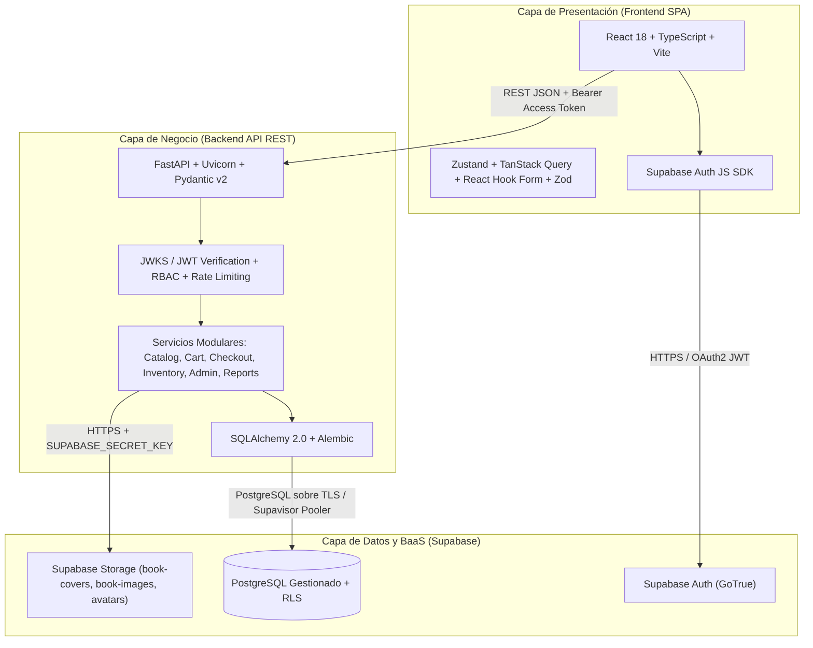
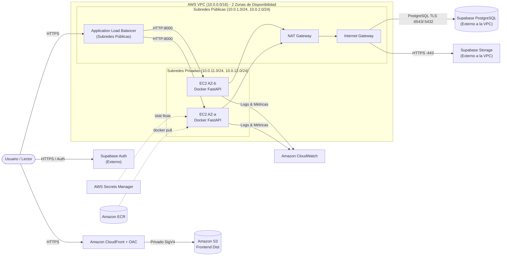

# Arquitectura Lógica y Cloud de BOOKLY

## 1. Arquitectura Lógica de Tres Capas

BOOKLY implementa una arquitectura monolítica modular desacoplada en tres capas independientes:

## 2. Arquitectura Cloud Computing (AWS + Supabase Externo)

Supabase es un servicio BaaS externo a la VPC de AWS; las instancias backend en subredes privadas se conectan hacia Supabase saliendo por NAT Gateway con cifrado TLS/HTTPS.

