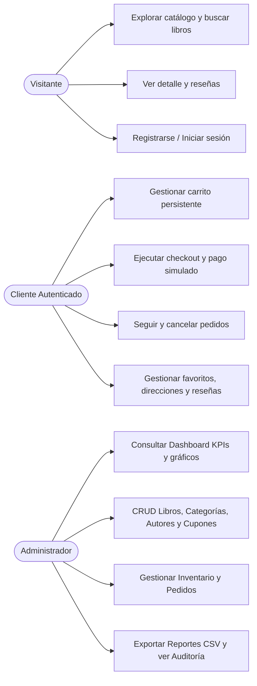
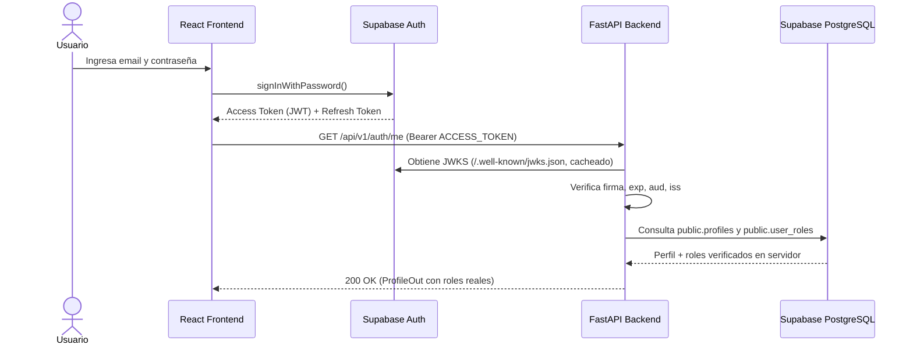
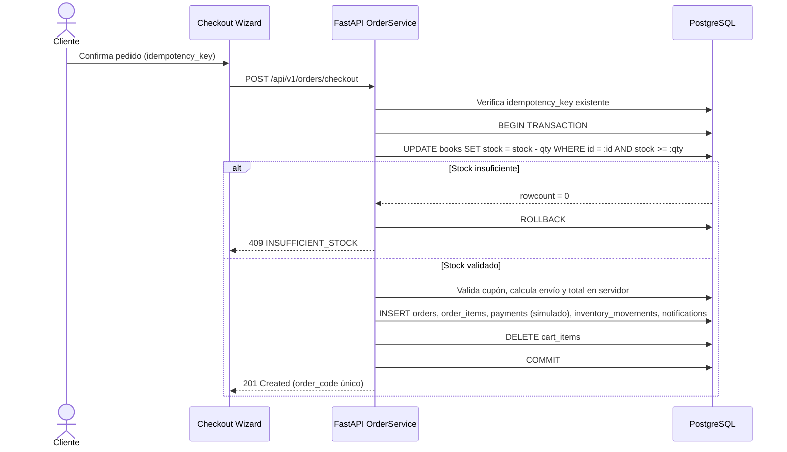
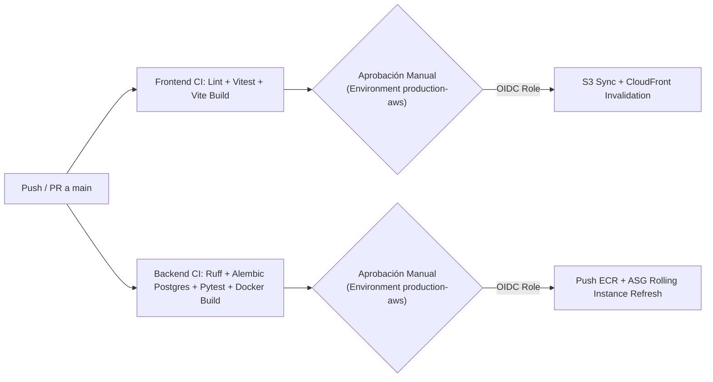

# Diagramas de Comportamiento y Despliegue de BOOKLY

## 1. Casos de Uso Principales

## 2. Secuencia de Autenticación (Supabase Auth + FastAPI)

## 3. Secuencia de Compra Transaccional e Idempotente

## 4. Flujo CI/CD en GitHub Actions

