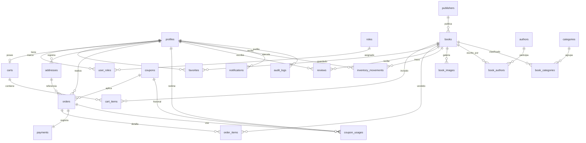

# Diagrama Entidad-Relación (23 Tablas Normalizadas)

El esquema de datos de BOOKLY es gestionado mediante Alembic (`backend/alembic/versions/0001_initial_schema.py`) y enlazado con `auth.users` de Supabase.

## Convenciones de Integridad
- Todas las claves primarias utilizan `UUID`.
- Todos los importes monetarios utilizan `NUMERIC(10, 2)` (`DECIMAL`).
- Restricciones `CHECK` impiden precios negativos, porcentajes fuera de `[0, 100]`, stock negativo (`stock >= 0`) y calificaciones fuera de `[1, 5]`.
- Eliminación lógica (`deleted_at`) en entidades maestras (`profiles`, `books`, `authors`, `categories`, `publishers`, `addresses`, `reviews`, `coupons`).
